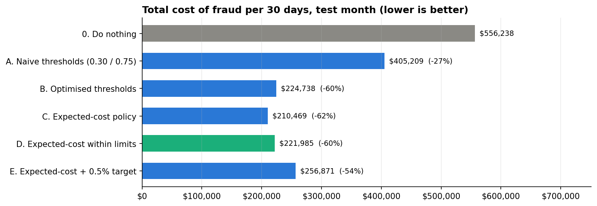
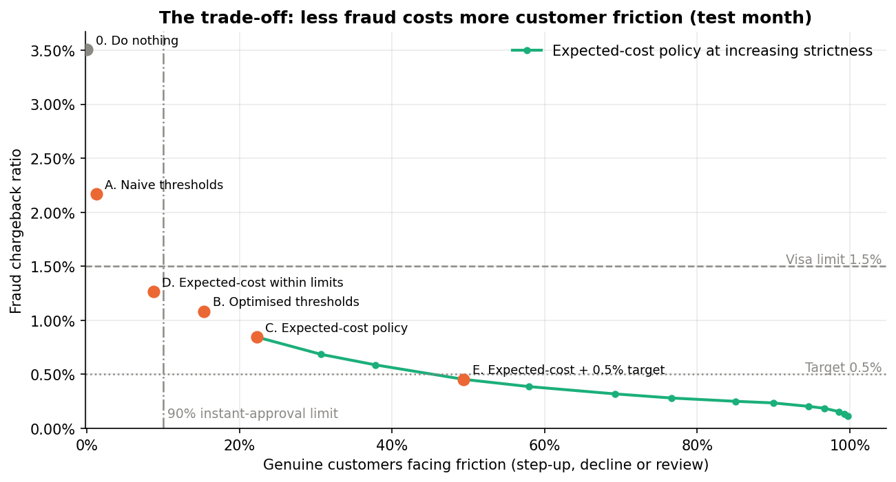
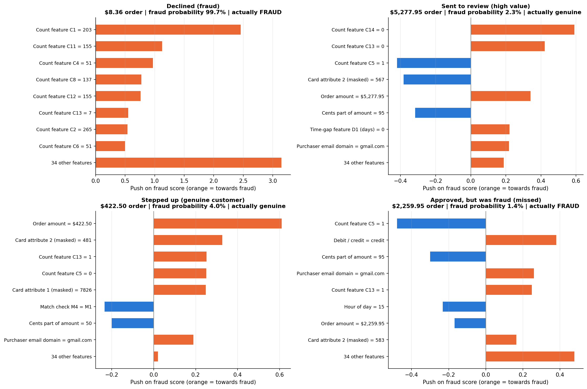

# 💳 Chargeback Reduction: A Cost-Optimised Fraud Risk Framework

> An end-to-end fraud risk project that links a **corporate risk assessment** to a **machine-learning model**, and measures success in **dollars saved and customer friction**, not accuracy.

**Result on an unseen test month:** the recommended policy cuts the total cost of fraud by **60% (about $334k per 30 days)**, brings the fraud ratio from **3.50% to 1.27%** (under Visa's 1.5% limit, no fines) and still approves **91% of genuine customers instantly**.



---

## The business problem

**NovaCart**, a fictional online retailer (its transactions are the real [IEEE-CIS Fraud Detection](https://www.kaggle.com/c/ieee-fraud-detection) dataset), has no fraud screening:

| | Measured |
|---|---|
| Fraud ratio (what card networks monitor) | **3.50%**, 2.3× Visa's 1.5% VAMP limit, every month |
| Fraud as share of revenue | **3.9%** |
| Cost of doing nothing (lost orders + chargeback fees + network fines) | **$3.77M over 6 months, about $619k a month** |
| Fraud per day vs manual-review capacity | **~113 frauds** vs **100 review slots**, so analysts alone can't cope |

Above the network limit, NovaCart pays fines and risks losing its payment processor. The full one-page risk assessment, objectives and recommendation are in [`docs/business_brief.md`](docs/business_brief.md).

## The solution: a 3-stage risk lifecycle

```
[Order] ──> [1. Score] ──────────> [2. Decide] ─────────────────────────> [3. Act]
            LightGBM fraud         lowest expected $ cost, using          🟢 Approve
            probability            probability AND order value,           🟡 Step-up (SMS / 3-D Secure)
            (calibrated)           within ≤100 reviews/day and            🔴 Decline
                                   ≥90% instant approval                  🔍 Manual review
                                                                          + SHAP reason codes
```

## Results (test month, 85,430 orders)

| Policy | Cost / 30 days | Saving | Fraud ratio | Genuine customers approved instantly | Reviews/day (max) |
|---|---|---|---|---|---|
| 0. Do nothing | $556k | — | 3.50% | 100% | 0 |
| A. Textbook thresholds (0.30 / 0.75) | $405k | 27% | 2.17% | 98.8% | 64 |
| B. Cost-optimised thresholds | $225k | 60% | 1.08% | 84.6% | 20 |
| C. Expected-cost (no friction limit) | $210k | 62% | 0.85% | 77.7% | 70 |
| **D. Expected-cost within limits ⭐** | **$222k** | **60%** | **1.27%** | **91.3%** | **58** |
| E. Expected-cost forced to 0.5% | $257k | 54% | 0.45% | 50.6% | 100 |

**Key findings**

- **Textbook thresholds fail.** The common 0.30 / 0.75 rule saves only 27% and leaves NovaCart above Visa's limit.
- **Order value matters.** Deciding on *fraud probability × order amount* matches the savings of optimised thresholds with about **7 points less customer friction** (91.3% vs 84.6% instant approval).
- **Customer experience is cheap to protect.** The 90% instant-approval limit costs only ~$11k a month versus the unconstrained optimum.
- **The 0.5% target isn't worth forcing with this model.** It needs extra checks for half of all genuine customers and costs $35k a month more. The recommended route is better data (device/identity), not stricter rules.
- **Robust to assumptions.** Savings stay between **58% and 64%** under seven alternative cost scenarios.



### Why was this order flagged?

Every flagged order gets **SHAP reason codes**. Declines are driven mainly by extreme count patterns typical of **card testing** (e.g. an **$8.36** order on a card linked to **203** addresses); reviews mainly by **order value**, so expensive, uncertain orders go to people. The fraud the policy misses looks like an ordinary customer, which is why device and identity data are the next step.



## Why not accuracy?

96.5% of orders are genuine, so a model that approves everything is "96.5% accurate" and useless. This project reports what the business and card networks care about:

| Metric | Why it matters |
|---|---|
| **Total cost of fraud ($)** | Missed fraud, fees, fines, lost customers, verification and review costs together |
| **Fraud chargeback ratio** | What Visa and Mastercard monitor |
| **Instant approval of genuine customers** | Checkout friction |
| **Reviews per day** | Operational capacity |
| **PR-AUC** | Model quality on imbalanced data: **0.50 on the test month, 14× better than random** |

## Methodology

Split by time, never at random · no oversampling or class weights (keeps probabilities honest) · every threshold and setting chosen on validation, test used once · review cap enforced day by day · Visa fines charged only in months above the limit.

## Project structure

```
fraud-detection-risk/
├── docs/business_brief.md   # Risk assessment, objectives, results, recommendation
├── notebooks/               # Steps 2-5 (run on Kaggle), with outputs
├── src/policy.py            # Reusable cost model, policies and evaluation
├── tests/test_policy.py     # Checks src/ reproduces the Step 4 results
├── app/                     # Test-month scores + assumptions (input for the planned dashboard)
├── reports/                 # Figures and JSON summaries from each step
├── data/                    # Local data only (git-ignored), see data/README.md
└── requirements.txt
```

## How to run

**Notebooks:** designed for Kaggle. Add the IEEE-CIS competition data as an input (Steps 4 and 5 also take the saved outputs of earlier notebooks; see each notebook's first section) and run top to bottom.

**Re-run the recommended policy locally** (needs only `numpy` and `pandas`):

```python
import json, pandas as pd
from src.policy import recommended_policy, evaluate

orders = pd.read_csv("app/test_scores.csv.gz")          # test month: probabilities, amounts, labels
A = json.load(open("app/assumptions.json"))             # cost assumptions
actions = recommended_policy(orders, A)                  # 0 approve, 1 step-up, 2 decline, 3 review
print(evaluate(orders, actions, A)["cost_per_30_days"]) # ≈ $221,985
```

**Verify:** `python tests/test_policy.py` checks the package reproduces Step 4's published numbers.

## Limitations

Cost assumptions (margin, churn, abandonment, analyst figures) are stated assumptions, not NovaCart data, though sensitivity analysis shows the conclusion holds across reasonable ranges. Results come from one 30-day test month, and most IEEE-CIS features are masked, so some explanations can't be mapped to an exact business meaning. Details in [`docs/business_brief.md`](docs/business_brief.md#9-key-risks-and-limitations).

---

*Portfolio project. NovaCart is fictional; transactions are from the IEEE-CIS Fraud Detection dataset (Vesta Corporation); industry figures are sourced in the business brief.*
